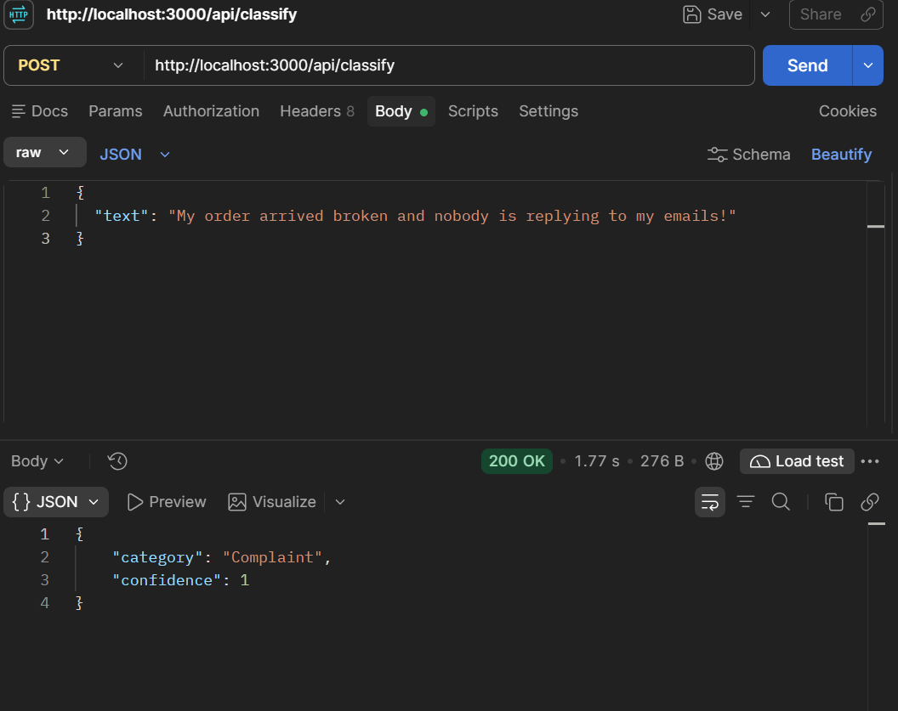
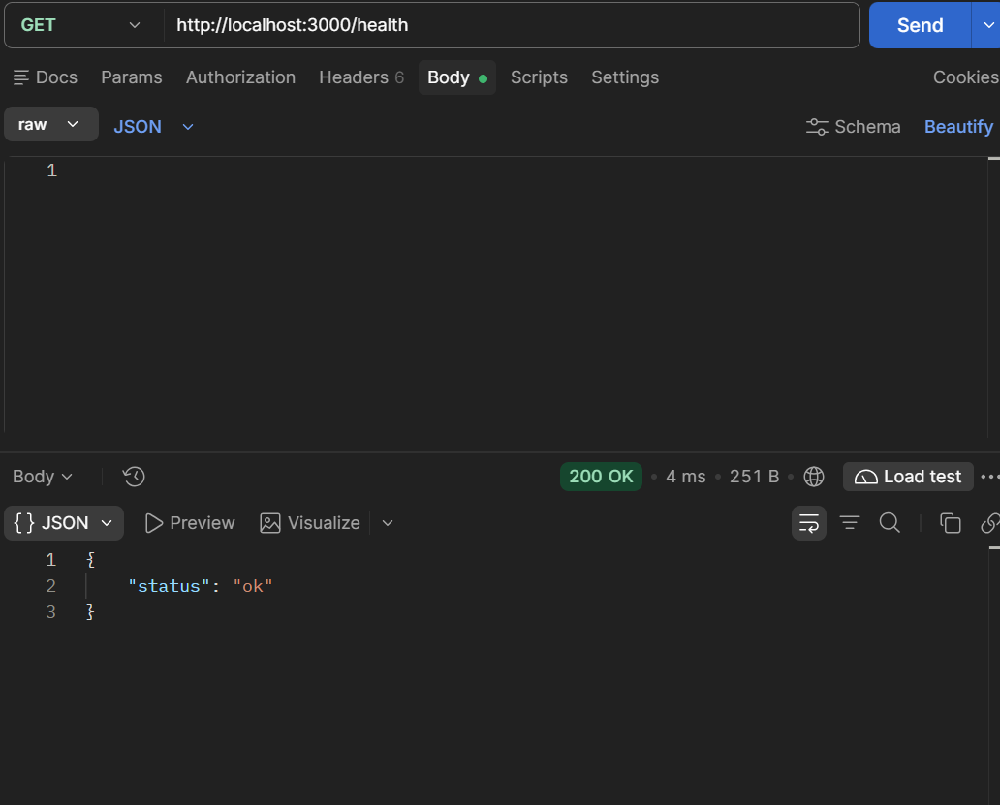
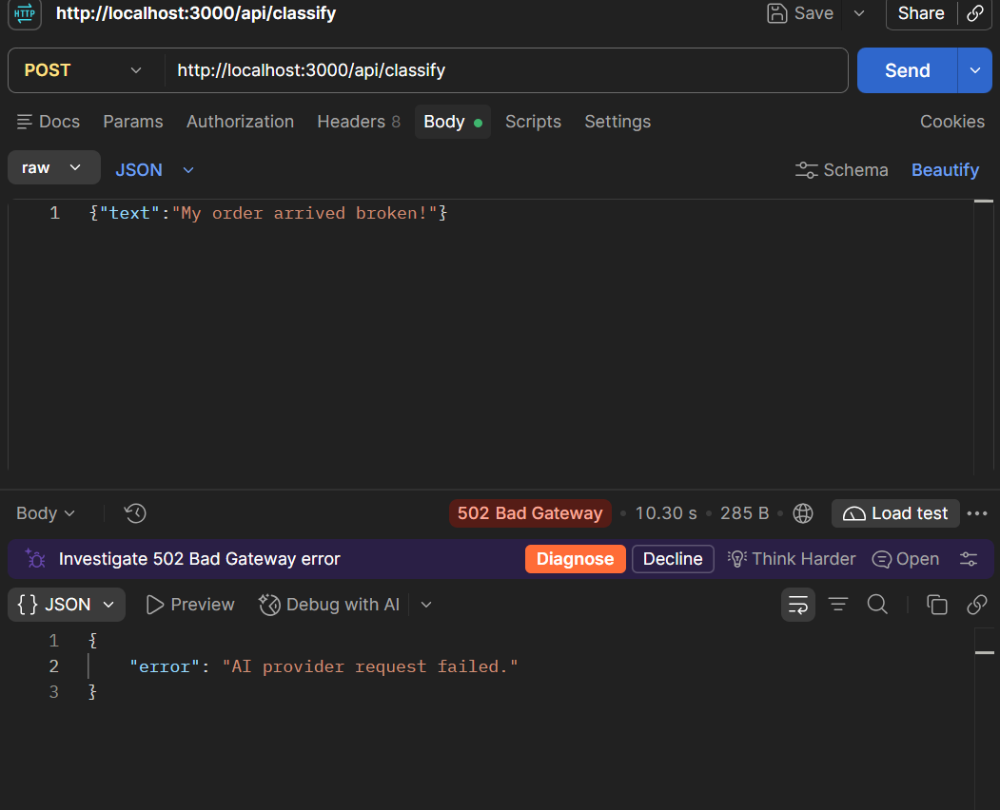

# AI-Assisted Text Classification API

A small backend service that classifies a piece of text as **Complaint**, **Query**, **Feedback** or **Other** using an AI model, and returns the category along with a confidence score.

Built with **Node.js** and **Express**.
---

## Features

- Single REST endpoint: `POST /api/classify`
- Classification done by an AI model through any OpenAI-compatible provider, which i have tested with Google Gemini
- Returns `category` and `confidence` (0 to 1)
- Output validation, with a fallback confidence if the model doesn't return a usable one
- Timeout and automatic retries for temporary AI provider failures
- Clean separation of routes, controller, service and error handling
- Environment-variable configuration, with a startup check for missing values

---

## Project Structure

```
.
├── server.js                      # Entry point: loads env, validates config, starts server
├── app.js                         # Express app: middleware, routes, error handlers
├── routes/
│   └── classify.routes.js         # Defines POST /classify
├── controllers/
│   └── classify.controller.js     # Handles request/response, validates input
├── services/
│   └── classifier.service.js      # Talks to the AI model, parses and normalizes output
├── middleware/
│   └── errorHandler.js            # 404 handler and central error handler
├── .env.example                   # Template for environment variables
└── README.md
```

---

## Setup

### Prerequisites

- **Node.js 18/ anything newer**
- An API key from an OpenAI-compatible AI provider (for this i have used a free key from [Google AI Studio](https://aistudio.google.com))

### Installation

```bash
git clone <your-repo-url>
cd <your-repo-folder>
npm install
```

### Environment variables


```bash
cp .env.example .env
```

| Variable      | Description                                                                 | Example                                                   |
|---------------|-----------------------------------------------------------------------------|-----------------------------------------------------------|
| `AI_API_KEY`  | API key for the AI provider                                                 | `your_api_key_here`                                       |
| `AI_BASE_URL` | Provider's OpenAI-compatible base URL (**without** `/chat/completions`)     | `https://generativelanguage.googleapis.com/v1beta/openai` |
| `AI_MODEL`    | Model name exactly as the provider lists it                                 | `gemini-2.5-flash-lite`                                   |
| `PORT`        | Port for the server (optional, defaults to `3000`)                          | `3000`                                                    |


### Run

```bash
node server.js
```

In bash or terminal, we will see:

```
Text Classification API running on http://localhost:3000
```

---

## API Reference

### `POST /api/classify`

Classifies the given text.

**Request headers**

```
Content-Type: application/json
```

**Request body**

| Field  | Type   | Required | Description         |
|--------|--------|----------|---------------------|
| `text` | string | yes      | The text to classify |

**Example request and responses in Postman**



```json
{
  "category": "Complaint",
  "confidence": 0.95
}
```

The `confidence` value comes from the model and will vary between texts and models.

**examples**

| Input text                          | Expected category |
|-------------------------------------|-------------------|
| `My order arrived broken!`          | Complaint         |
| `How do I reset my password?`       | Query             |
| `Great app, please add dark mode.`  | Feedback          |
| `The weather is nice today.`        | Other             |

### `GET /health`

Simple health check. Returns `{ "status": "ok" }`.


### Error responses

All errors return JSON in the form `{ "error": "<message>" }`.

The above error was fixed by changing the model.
| Status | When it happens                                                        |
|--------|------------------------------------------------------------------------|
| 400    | Invalid JSON body, or `text` is missing or not a valid string          |
| 404    | Route does not exist                                                   |
| 502    | The AI provider failed after retries, or its reply could not be parsed |
| 500    | Unexpected server error (details are hidden from the client)           |

Request bodies are limited to **10 KB**.

---

## How AI Was Used

The classification itself is done by an AI model.T

The service sends two messages to the model's chat completions endpoint
The prompt defines the four categories and what each one means, and tells the model to answer with only a JSON object:

  ```json
  {"category": "<Complaint|Query|Feedback|Other>", "confidence": <number between 0 and 1>}
  ```

  | Category  | Definition                                                                  |
  |-----------|-----------------------------------------------------------------------------|
  | Complaint | The sender is unhappy, reporting a problem or a bad experience              |
  | Query     | The sender is asking a question or requesting information/help              |
  | Feedback  | The sender shares an opinion, praise or a suggestion, with no problem or question |
  | Other     | Anything that does not fit the above                                        |

Since AI replies can be messy the service validates them before returning.
It extracts the JSON object from the model's reply and the model's own confidence is used when it is a valid number. If it is missing or invalid, a default of `0.5` is used. The value is clamped to the range 0 to 1 and rounded to two decimals.


## Tech Stack

- Node.js (18+)
- Express
- dotenv
- Any OpenAI-compatible AI provider (tested with Google Gemini)